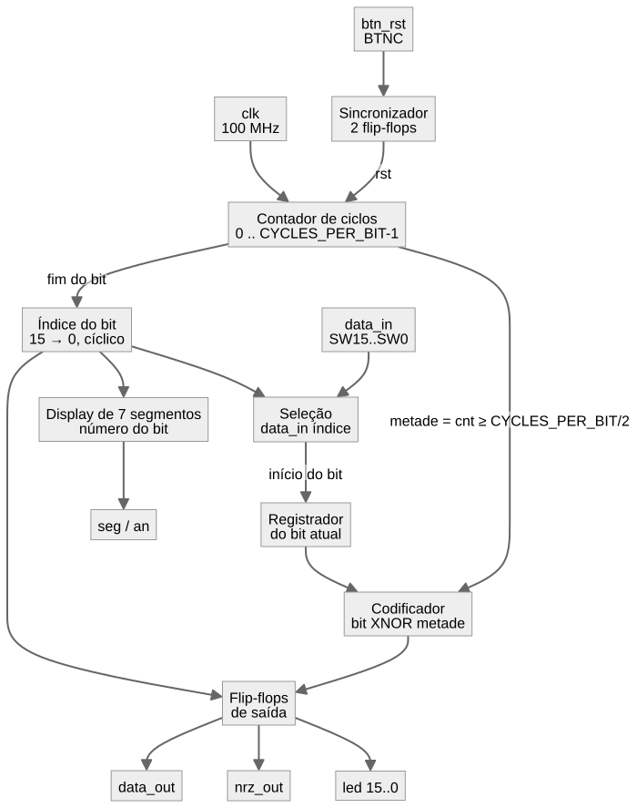

# Documentação Técnica: Codificador Manchester

> Rascunho em Markdown da `documentacao_projeto.pdf`. Ao final, este conteúdo deve ser passado para o modelo comum de PDF do grupo.

## 1. Visão geral

O módulo `manchester` implementa um codificador de linha Manchester segundo a **convenção IEEE 802.3** (Ethernet). Na codificação Manchester, cada intervalo de bit é dividido em duas metades e sempre há uma transição no meio do bit. O valor do bit é representado pelo **sentido** dessa transição:

| Bit | 1ª metade | 2ª metade | Transição no meio do bit |
|:---:|:---:|:---:|:---:|
| 0 | nível alto | nível baixo | descida (alto → baixo) |
| 1 | nível baixo | nível alto | subida (baixo → alto) |

Existe também a convenção de G. E. Thomas, com os sentidos invertidos; ela **não** é usada neste projeto.

O circuito recebe uma sequência de 16 bits pelos switches da placa Basys 3 e a transmite de forma cíclica, do bit mais significativo (SW15) ao menos significativo (SW0). O sinal codificado é apresentado no LED que fica acima do switch em transmissão e na porta `data_out`, que pode ser levada ao conector PMOD.

## 2. Diagrama de blocos

*Figura: diagrama de blocos do circuito. A fonte editável do diagrama está em `docs/midia/diagrama_blocos.mmd` (formato Mermaid).*

## 3. Interface

| Porta | Direção | Tipo | Função |
|---|:---:|---|---|
| `clk` | entrada | `std_logic` | Clock de 100 MHz da placa |
| `btn_rst` | entrada | `std_logic` | Reset (botão BTNC); enquanto pressionado, a transmissão fica parada e a saída em nível baixo |
| `data_in` | entrada | `std_logic_vector(15 downto 0)` | Sequência de bits (switches SW15..SW0, para cima = 1) |
| `data_out` | saída | `std_logic` | Sinal codificado em Manchester |
| `nrz_out` | saída | `std_logic` | Bit em transmissão, no formato NRZ (dado original) |
| `led` | saída | `std_logic_vector(15 downto 0)` | LEDs LD15..LD0; só o LED do bit em transmissão recebe o sinal codificado |
| `seg` | saída | `std_logic_vector(6 downto 0)` | Segmentos g..a do display de 7 segmentos (ativos em 0) |
| `an` | saída | `std_logic_vector(3 downto 0)` | Anodos AN3..AN0 do display (ativos em 0) |

## 4. Parâmetros (generics)

| Generic | Tipo | Valor padrão | Função |
|---|---|---|---|
| `CYCLES_PER_BIT` | `positive` | `100_000_000` | Duração de cada bit em ciclos de clock. **Deve ser par**, para que as duas metades do bit tenham a mesma duração; um `assert` interrompe a síntese e a simulação caso contrário |

Valores usados no projeto:

| Uso | `CYCLES_PER_BIT` | Duração do bit (clock de 100 MHz) |
|---|---|---|
| Placa (LEDs) | `100_000_000` | 1 s (0,5 s por metade) |
| Saída PMOD (osciloscópio) | `100_000` | 1 ms (taxa de 1 kbit/s) |
| Testbench | `10` | 100 ns (clock simulado de 10 ns) |

Com o valor padrão, o contador de ciclos precisa de 27 bits (227 = 134 217 728 > 100 000 000).

## 5. Funcionamento interno

**Sincronizador do botão.** O sinal do BTNC é assíncrono em relação ao clock. Ele passa por dois flip-flops em série antes de ser usado como reset síncrono, o que reduz o risco de metaestabilidade.

**Contador de ciclos.** Conta de 0 até `CYCLES_PER_BIT − 1` e volta a zero. O valor 0 marca o início do bit, `CYCLES_PER_BIT/2` marca o meio do bit e `CYCLES_PER_BIT − 1` marca o fim. O sinal que indica a metade do bit vale `0` enquanto o contador é menor que `CYCLES_PER_BIT/2` e `1` a partir daí.

**Índice do bit.** Começa em 15 e decrementa a cada fim de bit; após o bit 0, volta a 15. Ele seleciona qual switch é transmitido e qual LED recebe o sinal.

**Registrador do bit atual.** No início de cada bit (contador em 0), o valor de `data_in(índice)` é lido e guardado. Durante o restante do intervalo, o codificador usa o valor guardado. Assim, alterar um switch no meio do bit não altera o bit em transmissão; a mudança aparece na próxima vez que aquele bit for transmitido.

**Codificador.** A saída depende apenas do bit atual e da metade do bit:

| Bit | Metade | Saída |
|:---:|:---:|:---:|
| 0 | 0 (1ª) | 1 |
| 0 | 1 (2ª) | 0 |
| 1 | 0 (1ª) | 0 |
| 1 | 1 (2ª) | 1 |

A tabela-verdade corresponde à porta **XNOR**: `saída = bit XNOR metade`.

**Saídas registradas.** O sinal codificado, o dado original e o vetor de LEDs saem de flip-flops, e não diretamente de lógica combinacional. Isso evita pulsos espúrios (*glitches*) que apareceriam no osciloscópio. O vetor de LEDs é zerado a cada ciclo e apenas a posição do índice recebe o sinal codificado.

**Reset.** Enquanto o reset está ativo, o contador vai para 0, o índice para 15 e todas as saídas para nível baixo. Ao soltar o botão, a transmissão começa em SW15. Entre soltar o botão e o primeiro bit aparecer na saída há uma latência de 3 ciclos de clock (2 do sincronizador e 1 do flip-flop de saída), desprezível frente à duração do bit.

**Display de 7 segmentos.** O submódulo `display_7seg` recebe o índice do bit e o mostra em decimal nos dois displays da direita (AN1 = dezena, AN0 = unidade), apagando a dezena para números menores que 10. Como os quatro displays compartilham os segmentos, eles são acesos alternadamente: o bit mais significativo de um contador de 17 bits escolhe entre unidade e dezena, de modo que cada display é atualizado a cerca de 380 Hz, sem cintilação perceptível. Durante o reset, o display fica apagado.

**Variações para as saídas PMOD e VGA.** O mesmo módulo é instanciado, sem alterações, pelos tops das pastas `saidas/`: na saída PMOD, com `CYCLES_PER_BIT = 100_000` (1 ms por bit) e as saídas `data_out` e `nrz_out` ligadas aos pinos JA1 e JA2; na saída VGA, com 1 s por bit e `data_out` ligado ao controlador VGA, que pinta a tela de verde (nível alto) ou azul (nível baixo).

## 6. Mapeamento físico na placa

| Sinal | Componente | Pino |
|---|---|---|
| `clk` | Oscilador de 100 MHz | W5 |
| `btn_rst` | Botão central (BTNC) | U18 |
| `data_in(0..15)` | SW0..SW15 | V17, V16, W16, W17, W15, V15, W14, W13, V2, T3, T2, R3, W2, U1, T1, R2 |
| `led(0..15)` | LD0..LD15 | U16, E19, U19, V19, W18, U15, U14, V14, V13, V3, W3, U3, P3, N3, P1, L1 |
| `data_out` | PMOD JA1 | J1 |
| `nrz_out` | PMOD JA2 | L2 |
| `seg(0..6)` | Segmentos CA..CG | W7, W6, U8, V8, U5, V5, U7 |
| `an(0..3)` | Anodos AN0..AN3 | U2, U4, V4, W4 |

Os pinos seguem o arquivo `Basys-3-Master.xdc` da Digilent.

## 7. Dependências e ambiente

| Item | Valor |
|---|---|
| Ferramenta | AMD Vivado 2025.2 |
| Simulador | Vivado Simulator |
| Placa | Digilent Basys 3 (Artix-7 `xc7a35tcpg236-1`) |
| Linguagem | VHDL-93 |
| Bibliotecas | `ieee.std_logic_1164` e `ieee.numeric_std` (no display) |
