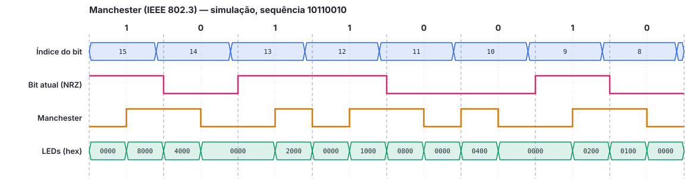

# Tutorial de Simulação: Codificador Manchester

> Rascunho em Markdown do `tutorial_simulacao.pdf`. Os trechos **[print: ...]** marcam onde entram as capturas de tela do Vivado, que devem ser salvas em `docs/midia/` durante a execução do tutorial.

Este tutorial mostra como abrir o projeto do codificador Manchester no Vivado, executar a simulação comportamental e interpretar a forma de onda.

## 1. Pré-requisitos

| Item | Versão |
|---|---|
| AMD Vivado (edição gratuita *Standard*) | **a definir pelo grupo** |
| Sistema operacional | Windows 10/11 ou Linux |
| Repositório do grupo | clonado em um caminho **sem espaços e sem acentos** (ex.: `C:\fpga\modulacao_manchester_vhdl_fpga`) |

## 2. Abertura do projeto

O projeto pode ser aberto de duas formas.

**Opção A: projeto já salvo no repositório.** No Vivado, clicar em **Open Project** e selecionar `manchester/vivado_project/manchester.xpr`.

**[print: tela inicial do Vivado com Open Project]**

**Opção B: recriar o projeto pelo script.** Útil quando o `.xpr` não existe ou apresenta problemas de caminho:

1. Abrir o Vivado e, no menu **Window**, abrir o **Tcl Console**;
2. Navegar até a pasta do projeto e executar o script:
   ```tcl
   cd C:/fpga/modulacao_manchester_vhdl_fpga/manchester/vivado_project
   source create_project.tcl
   ```
   No Tcl Console, os caminhos usam `/` mesmo no Windows.

O script cria o projeto para a FPGA da Basys 3 (`xc7a35tcpg236-1`), adiciona o código-fonte, o testbench e as constraints e configura o tempo de simulação.

**[print: Tcl Console após o script, com a mensagem "Projeto manchester criado"]**

## 3. Estrutura dos arquivos no Vivado

No painel **Sources**, os arquivos aparecem em três grupos:

| Grupo | Arquivo | Função |
|---|---|---|
| Design Sources | `manchester.vhd` | Código-fonte do codificador (**top** da síntese, em negrito) |
| Constraints | `manchester.xdc` | Mapeamento dos pinos da placa |
| Simulation Sources › sim_1 | `manchester_tb.vhd` | Testbench (**top** da simulação, em negrito) |

**[print: painel Sources com os três grupos expandidos]**

## 4. Configuração da simulação

1. Em **Simulation Sources**, conferir que `manchester_tb` está em negrito. Se não estiver, clicar com o botão direito sobre ele e escolher **Set as Top**;
2. Em **Flow Navigator › Settings › Simulation**, aba **Simulation**, conferir que `xsim.simulate.runtime` está em `4us`. O testbench termina em aproximadamente 3,9 µs.

**[print: janela Settings com xsim.simulate.runtime]**

O testbench usa os seguintes parâmetros, que podem ser alterados no início do arquivo `manchester_tb.vhd`:

| Constante | Valor | Significado |
|---|---|---|
| `CLK_PERIOD` | 10 ns | Período do clock simulado (100 MHz) |
| `CYCLES_PER_BIT` | 10 | Ciclos de clock por bit, passado ao circuito via `generic map` |
| `BIT_PERIOD` | 100 ns | Duração do bit (`CYCLES_PER_BIT × CLK_PERIOD`) |

## 5. Execução da simulação

Em **Flow Navigator › Simulation**, clicar em **Run Simulation › Run Behavioral Simulation**.

O testbench verifica automaticamente cada metade de cada bit. Ao final, o **Tcl Console** deve mostrar:

```
Note: Simulacao concluida sem erros
```

Qualquer divergência aparece como `Error:` no console, com o número do bit e a metade em que ocorreu.

**[print: Tcl Console com a mensagem "Simulacao concluida sem erros"]**

## 6. Visualização da forma de onda

1. No painel **Scope**, expandir `manchester_tb` e selecionar `dut`;
2. No painel **Objects**, arrastar para a janela de forma de onda os sinais `idx` (índice do bit) e `bit_reg` (bit atual). Os sinais `data_out`, `nrz_out` e `led` do testbench já aparecem por padrão;
3. Clicar com o botão direito em `idx` › **Radix › Unsigned Decimal**, e em `led` › **Radix › Hexadecimal**;
4. Ordenar os sinais: `idx`, `bit_reg`, `data_out`, `led`;
5. Clicar em **Zoom Fit** e depois aproximar o trecho entre 0 e 1 µs;
6. Clicar com o botão direito em `clk` e removê-lo, se a visualização ficar poluída;
7. Salvar a configuração em **File › Simulation Waveform › Save Configuration As**, com o nome `manchester_tb_behav.wcfg`, na pasta `vivado_project/`.

**[print: forma de onda com idx, bit_reg, data_out e led lado a lado]**

## 7. Resultado esperado

A primeira volta do testbench transmite a sequência `1011001011110000`, cujos oito primeiros bits são os do exemplo do enunciado. A figura abaixo foi gerada a partir da mesma simulação e serve de referência para conferir a forma de onda do Vivado:



O que conferir:

- **Índice do bit:** começa em 15 e decrementa a cada bit (15, 14, 13...), voltando a 15 depois do 0;
- **Transição no meio de todos os bits:** o sinal Manchester sempre muda de nível no meio do bit;
- **Convenção IEEE 802.3:** bit **1** = nível baixo e depois alto (subida no meio); bit **0** = nível alto e depois baixo (descida no meio);
- **LEDs:** apenas o LED do bit em transmissão recebe o sinal (`8000` = LD15, `4000` = LD14...); quando o sinal está em nível baixo, todos ficam apagados (`0000`);
- **Reset:** durante o reset (início da simulação e entre 3,5 µs e 3,65 µs), todas as saídas ficam em nível baixo, e a transmissão recomeça em SW15 quando o botão é solto.

O índice muda um ciclo de clock antes das saídas, pois as saídas passam por um flip-flop antes de deixar o circuito.
