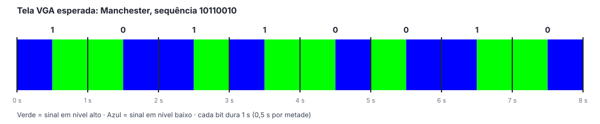

# Saída VGA com Cores Pulsantes: Manchester

Apresenta o sinal codificado em Manchester na saída VGA da Basys 3, mudando a cor da tela inteira conforme o nível do sinal: **verde** em nível alto e **azul** em nível baixo. Com 1 s por bit, a tela pisca evidenciando as duas metades de cada bit, o que torna a codificação visível à distância e facilita a gravação do vídeo de demonstração.

## Estrutura desta pasta

```
vga/
├── src/               Controlador VGA e top manchester_vga
├── sim/               Testbenches do controlador e do top
├── constraints/       Mapeamento dos pinos, incluindo o conector VGA
├── vivado_project/    Script que cria o projeto Vivado desta saída
└── docs/              Tutorial, fotos e vídeos da tela
    └── midia/
```

## Arquivos de código

- `src/vga_controller.vhd`: gera hsync e vsync no padrão 640x480 @ 60 Hz (clock de pixel de 25 MHz, obtido a partir dos 100 MHz) e pinta a área visível com uma cor para cada nível do sinal
- `src/manchester_vga.vhd`: top que liga o núcleo `../../src/manchester.vhd` (sem cópia) ao controlador VGA; LEDs e display de 7 segmentos continuam funcionando
- `sim/vga_controller_tb.vhd`: confere os períodos e as larguras dos sincronismos e as cores
- `sim/manchester_vga_tb.vhd`: confere que a cor da tela acompanha o sinal codificado

O controlador VGA não é reiniciado pelo BTNC: o botão reinicia apenas a transmissão, e o monitor não perde o sincronismo.

## Equipamentos necessários

- Placa FPGA Basys 3 e cabo USB
- Monitor com entrada VGA (ou adaptador VGA para HDMI ativo)
- Cabo VGA

## Como reproduzir

1. Criar o projeto Vivado executando `vivado_project/create_project.tcl` no Tcl Console;
2. Gerar o bitstream e gravar a placa;
3. Ligar o monitor no conector VGA da placa;
4. Configurar os switches e observar a tela.

Os detalhes estão no [tutorial completo](./docs/tutorial_vga.pdf).

## Tela esperada


