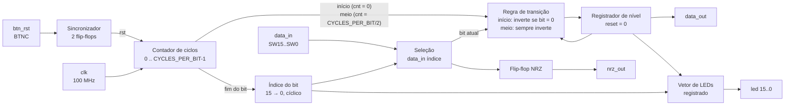

# Documentação Técnica: Codificador Manchester Diferencial

> Rascunho em Markdown da `documentacao_projeto.pdf`. Ao final, este conteúdo deve ser passado para o modelo comum de PDF do grupo.

## 1. Visão geral

O módulo `manchester_dif` implementa um codificador de linha Manchester Diferencial. Cada intervalo de bit é dividido em duas metades e **sempre há uma inversão do nível no meio do bit**, usada apenas para sincronismo. O valor do bit é representado pela presença ou ausência de inversão no **início** do intervalo:

| Bit | Início do intervalo | Meio do intervalo |
|:---:|---|---|
| 0 | ocorre inversão do nível | ocorre inversão do nível |
| 1 | mantém o nível anterior | ocorre inversão do nível |

Como a regra depende do nível anterior, o circuito memoriza o último nível transmitido. **O nível da saída após o reset é baixo.**

O circuito recebe uma sequência de 16 bits pelos switches da placa Basys 3 e a transmite de forma cíclica, do bit mais significativo (SW15) ao menos significativo (SW0). O sinal codificado é apresentado no LED que fica acima do switch em transmissão e na porta `data_out`, que pode ser levada ao conector PMOD.

## 2. Diagrama de blocos

## 3. Interface

| Porta | Direção | Tipo | Função |
|---|:---:|---|---|
| `clk` | entrada | `std_logic` | Clock de 100 MHz da placa |
| `btn_rst` | entrada | `std_logic` | Reset (botão BTNC); enquanto pressionado, a transmissão fica parada e a saída em nível baixo |
| `data_in` | entrada | `std_logic_vector(15 downto 0)` | Sequência de bits (switches SW15..SW0, para cima = 1) |
| `data_out` | saída | `std_logic` | Sinal codificado em Manchester Diferencial |
| `nrz_out` | saída | `std_logic` | Bit em transmissão, no formato NRZ (dado original) |
| `led` | saída | `std_logic_vector(15 downto 0)` | LEDs LD15..LD0; só o LED do bit em transmissão recebe o sinal codificado |

A interface é idêntica à do módulo `manchester`, o que permite reaproveitar os tops das saídas PMOD e VGA.

## 4. Parâmetros (generics)

| Generic | Tipo | Valor padrão | Função |
|---|---|---|---|
| `CYCLES_PER_BIT` | `positive` | `100_000_000` | Duração de cada bit em ciclos de clock. **Deve ser par**, para que as duas metades do bit tenham a mesma duração; um `assert` interrompe a síntese e a simulação caso contrário |

Valores usados no projeto:

| Uso | `CYCLES_PER_BIT` | Duração do bit (clock de 100 MHz) |
|---|---|---|
| Placa (LEDs) | `100_000_000` | 1 s (0,5 s por metade) |
| Saída PMOD (osciloscópio) | `100_000` | 1 ms (taxa de 1 kbit/s) |
| Testbench | `10` | 100 ns (clock simulado de 10 ns) |

## 5. Funcionamento interno

**Sincronizador, contador de ciclos e índice do bit.** Funcionam como no projeto Manchester: o BTNC passa por dois flip-flops antes de ser usado como reset síncrono; o contador vai de 0 a `CYCLES_PER_BIT − 1`; o índice começa em 15, decrementa a cada fim de bit e volta a 15 após o bit 0.

**Registrador de nível.** Guarda o último nível transmitido e é, ao mesmo tempo, o flip-flop que alimenta `data_out`. A cada ciclo de clock:

- **contador = 0 (início do bit):** lê `data_in(índice)`. Se o bit for 0, o nível é invertido; se for 1, o nível é mantido. O valor lido também é guardado no flip-flop de `nrz_out`;
- **contador = `CYCLES_PER_BIT/2` (meio do bit):** o nível é sempre invertido;
- **demais ciclos:** o nível é mantido.

Como o switch só é lido no início do bit, alterá-lo no meio do intervalo não afeta o bit em transmissão.

**Exemplo.** Para a sequência 1 0 1 1 a partir do reset (nível baixo):

| Bit | Nível anterior | Início do bit | 1ª metade | 2ª metade |
|:---:|:---:|---|:---:|:---:|
| 1 | 0 | mantém | 0 | 1 |
| 0 | 1 | inverte | 0 | 1 |
| 1 | 1 | mantém | 1 | 0 |
| 1 | 0 | mantém | 0 | 1 |

**Saídas registradas.** O sinal codificado, o dado original e o vetor de LEDs saem de flip-flops, evitando *glitches* no osciloscópio. O vetor de LEDs é zerado a cada ciclo e apenas a posição do índice recebe o nível atual.

**Reset.** Enquanto o reset está ativo, o contador vai para 0, o índice para 15 e o registrador de nível para **nível baixo**, assim como todas as saídas. Ao soltar o botão, a transmissão começa em SW15 aplicando a regra de transição a partir do nível baixo. A latência entre soltar o botão e o primeiro bit na saída é de 3 ciclos de clock.

## 6. Mapeamento físico na placa

| Sinal | Componente | Pino |
|---|---|---|
| `clk` | Oscilador de 100 MHz | W5 |
| `btn_rst` | Botão central (BTNC) | U18 |
| `data_in(0..15)` | SW0..SW15 | V17, V16, W16, W17, W15, V15, W14, W13, V2, T3, T2, R3, W2, U1, T1, R2 |
| `led(0..15)` | LD0..LD15 | U16, E19, U19, V19, W18, U15, U14, V14, V13, V3, W3, U3, P3, N3, P1, L1 |
| `data_out` | PMOD JA1 | J1 |
| `nrz_out` | PMOD JA2 | L2 |

Os pinos seguem o arquivo `Basys-3-Master.xdc` da Digilent.

## 7. Dependências e ambiente

| Item | Valor |
|---|---|
| Ferramenta | AMD Vivado (versão: **a definir pelo grupo**) |
| Simulador | Vivado Simulator |
| Placa | Digilent Basys 3 (Artix-7 `xc7a35tcpg236-1`) |
| Linguagem | VHDL-93 |
| Bibliotecas | `ieee.std_logic_1164` |
