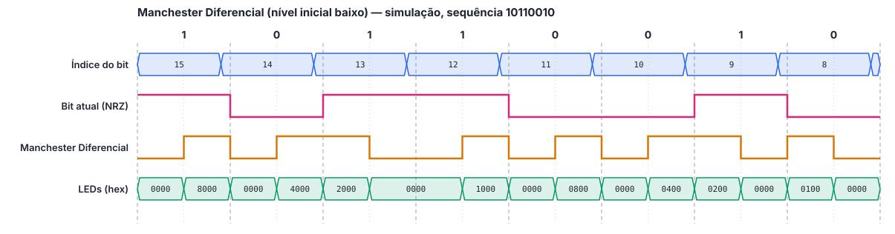

# Tutorial de Simulação: Codificador Manchester Diferencial

> Rascunho em Markdown do `tutorial_simulacao.pdf`. Os trechos **[print: ...]** marcam onde entram as capturas de tela do Vivado, que devem ser salvas em `docs/midia/` durante a execução do tutorial.

Este tutorial mostra como abrir o projeto do codificador Manchester Diferencial no Vivado, executar a simulação comportamental e interpretar a forma de onda.

## 1. Pré-requisitos

| Item | Versão |
|---|---|
| AMD Vivado (edição gratuita *Standard*) | **a definir pelo grupo** |
| Sistema operacional | Windows 10/11 ou Linux |
| Repositório do grupo | clonado em um caminho **sem espaços e sem acentos** (ex.: `C:\fpga\modulacao_manchester_vhdl_fpga`) |

## 2. Abertura do projeto

**Opção A: projeto já salvo no repositório.** No Vivado, clicar em **Open Project** e selecionar `manchester_diferencial/vivado_project/manchester_dif.xpr`.

**[print: tela inicial do Vivado com Open Project]**

**Opção B: recriar o projeto pelo script.**

1. Abrir o Vivado e, no menu **Window**, abrir o **Tcl Console**;
2. Navegar até a pasta do projeto e executar o script:
   ```tcl
   cd C:/fpga/modulacao_manchester_vhdl_fpga/manchester_diferencial/vivado_project
   source create_project.tcl
   ```
   No Tcl Console, os caminhos usam `/` mesmo no Windows.

**[print: Tcl Console após o script, com a mensagem "Projeto manchester_dif criado"]**

## 3. Estrutura dos arquivos no Vivado

| Grupo | Arquivo | Função |
|---|---|---|
| Design Sources | `manchester_dif.vhd` | Código-fonte do codificador (**top** da síntese, em negrito) |
| Constraints | `manchester_dif.xdc` | Mapeamento dos pinos da placa |
| Simulation Sources › sim_1 | `manchester_dif_tb.vhd` | Testbench (**top** da simulação, em negrito) |

**[print: painel Sources com os três grupos expandidos]**

## 4. Configuração da simulação

1. Em **Simulation Sources**, conferir que `manchester_dif_tb` está em negrito. Se não estiver, clicar com o botão direito sobre ele e escolher **Set as Top**;
2. Em **Flow Navigator › Settings › Simulation**, aba **Simulation**, conferir que `xsim.simulate.runtime` está em `4us`.

**[print: janela Settings com xsim.simulate.runtime]**

| Constante do testbench | Valor | Significado |
|---|---|---|
| `CLK_PERIOD` | 10 ns | Período do clock simulado (100 MHz) |
| `CYCLES_PER_BIT` | 10 | Ciclos de clock por bit, passado ao circuito via `generic map` |
| `BIT_PERIOD` | 100 ns | Duração do bit (`CYCLES_PER_BIT × CLK_PERIOD`) |

O testbench acompanha o nível esperado da saída a partir do reset (nível baixo) e calcula, para cada bit, se deve haver inversão no início do intervalo.

## 5. Execução da simulação

Em **Flow Navigator › Simulation**, clicar em **Run Simulation › Run Behavioral Simulation**. Ao final, o **Tcl Console** deve mostrar:

```
Note: Simulacao concluida sem erros
```

Qualquer divergência aparece como `Error:` no console, indicando o bit e se o erro foi na transição do início ou do meio do bit.

**[print: Tcl Console com a mensagem "Simulacao concluida sem erros"]**

## 6. Visualização da forma de onda

1. No painel **Scope**, expandir `manchester_dif_tb` e selecionar `dut`;
2. No painel **Objects**, arrastar para a janela de forma de onda os sinais `idx` (índice do bit) e `nivel_reg` (último nível transmitido);
3. Clicar com o botão direito em `idx` › **Radix › Unsigned Decimal**, e em `led` › **Radix › Hexadecimal**;
4. Ordenar os sinais: `idx`, `nrz_out` (bit atual), `data_out`, `led`;
5. Clicar em **Zoom Fit** e depois aproximar o trecho entre 0 e 1 µs;
6. Salvar a configuração em **File › Simulation Waveform › Save Configuration As**, com o nome `manchester_dif_tb_behav.wcfg`, na pasta `vivado_project/`.

**[print: forma de onda com idx, bit atual, data_out e led lado a lado]**

## 7. Resultado esperado

A primeira volta do testbench transmite a sequência `1011001011110000`, cujos oito primeiros bits são os do exemplo do enunciado, partindo do nível baixo. A figura abaixo foi gerada a partir da mesma simulação e serve de referência:



O que conferir:

- **Nível após o reset:** a saída começa em nível baixo;
- **Transição no meio de todos os bits:** o sinal sempre muda de nível no meio do bit;
- **Início do bit com bit 0:** há inversão do nível em relação ao fim do bit anterior (ex.: bits 14, 11, 10 e 8);
- **Início do bit com bit 1:** não há transição; o nível continua igual ao do fim do bit anterior (ex.: bits 15, 13, 12 e 9);
- **Bits iguais consecutivos:** a sequência `11` (bits 13 e 12) e `00` (bits 11 e 10) evidencia os dois casos da regra;
- **LEDs:** apenas o LED do bit em transmissão recebe o sinal (`8000` = LD15, `4000` = LD14...);
- **Reset no meio da transmissão:** entre 3,5 µs e 3,65 µs as saídas ficam em nível baixo, e a transmissão recomeça em SW15 partindo novamente do nível baixo.

O índice muda um ciclo de clock antes das saídas, pois as saídas passam por um flip-flop antes de deixar o circuito.
