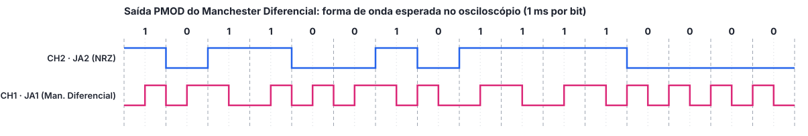

# Saída pelo PMOD (Osciloscópio): Manchester Diferencial

Disponibiliza o sinal codificado em Manchester Diferencial e o dado original (NRZ) em dois pinos do conector PMOD JA da Basys 3, permitindo visualizar as duas formas de onda ao mesmo tempo em um osciloscópio de dois canais. Para que os sinais tenham uma frequência adequada ao osciloscópio, a duração do bit é reduzida para **1 ms** (taxa de 1 kbit/s).

## Estrutura desta pasta

```
pmod_osciloscopio/
├── src/               Top manchester_dif_pmod (núcleo + pinos do PMOD)
├── sim/               Testbench do top na taxa real (1 ms por bit)
├── constraints/       Mapeamento dos pinos, incluindo JA1 e JA2
├── vivado_project/    Script que cria o projeto Vivado desta saída
└── docs/              Tutorial e capturas do osciloscópio
    └── midia/
```

O top `manchester_dif_pmod` reaproveita o núcleo `../../src/manchester_dif.vhd` (e o `display_7seg.vhd`) sem copiá-lo, alterando apenas o generic `CYCLES_PER_BIT` para `100_000`.

## Sinais no conector

| Pino | Sinal | Canal sugerido |
|---|---|---|
| JA1 (pino 1, FPGA J1) | Sinal codificado em Manchester Diferencial | CH1 |
| JA2 (pino 2, FPGA L2) | Dado original em NRZ | CH2 |
| GND (pino 5 ou 11) | Referência | garras de terra das pontas |

## Equipamentos necessários

- Placa FPGA Basys 3 e cabo USB
- Osciloscópio de dois canais
- Duas pontas de prova (ou cabos com garras) para conectar ao PMOD

## Como reproduzir

1. Criar o projeto Vivado executando `vivado_project/create_project.tcl` no Tcl Console;
2. Gerar o bitstream e gravar a placa;
3. Ligar as pontas de prova em JA1, JA2 e GND;
4. Configurar o osciloscópio e capturar as formas de onda.

Os detalhes estão no [tutorial completo](./docs/tutorial_pmod.pdf).

## Forma de onda esperada

Simulação do top com os switches em `1011001011110000`, partindo do nível baixo após o reset:


