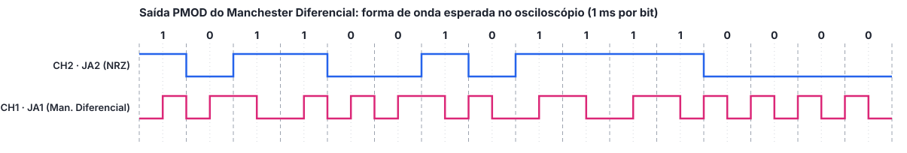

# Tutorial da Saída PMOD: Manchester Diferencial no Osciloscópio

> Rascunho em Markdown do `tutorial_pmod.pdf`. Os trechos **[foto: ...]** e **[print: ...]** marcam onde entram as imagens, que devem ser salvas em `docs/midia/` durante a execução.

Este tutorial mostra como gravar a saída PMOD do codificador Manchester Diferencial na Basys 3 e observar no osciloscópio o sinal codificado junto com o dado original.

## 1. Pré-requisitos

- Vivado instalado (mesma versão usada no projeto principal)
- Placa Basys 3 e cabo micro-USB
- Osciloscópio de dois canais e duas pontas de prova
- Projeto principal já simulado (ver o tutorial de simulação do Manchester Diferencial)

## 2. Criação do projeto Vivado

1. Abrir o Vivado e o **Tcl Console** (menu **Window**);
2. Executar:
   ```tcl
   cd C:/fpga/modulacao_manchester_vhdl_fpga/manchester_diferencial/saidas/pmod_osciloscopio/vivado_project
   source create_project.tcl
   ```
3. Conferir no painel **Sources** que `manchester_dif_pmod` é o top da síntese e que `manchester_dif.vhd` e `display_7seg.vhd` aparecem abaixo dele.

**[print: painel Sources do projeto manchester_dif_pmod]**

Opcionalmente, rodar **Run Behavioral Simulation**: o testbench simula 16 ms (pode levar alguns minutos) e deve terminar com `Simulacao concluida sem erros`.

## 3. Geração do bitstream e gravação

1. Clicar em **Generate Bitstream** (a síntese e a implementação são executadas automaticamente);
2. Conectar a placa pelo USB, com o jumper JP1 na posição **JTAG**, e ligar a chave **POWER**;
3. Em **Open Hardware Manager › Open Target › Auto Connect**, clicar em **Program Device**.

**[print: Hardware Manager com a placa conectada]**

## 4. Conexão do osciloscópio

O conector JA tem duas fileiras de 6 pinos. Na fileira identificada pelos pinos 1 a 6, os pinos 1 a 4 são os sinais **JA1 a JA4**, o pino 5 é **GND** e o pino 6 é **VCC (3,3 V)**; a outra fileira repete o padrão com JA7 a JA10, GND (pino 11) e VCC (pino 12). Conferir a numeração na serigrafia da placa antes de ligar as pontas e **nunca ligar a garra de terra no VCC**, o que colocaria a alimentação em curto.

| Ponta | Ligar em |
|---|---|
| CH1 (sinal) | JA1: sinal Manchester Diferencial |
| CH2 (sinal) | JA2: dado NRZ |
| Garras de terra | GND (pino 5 ou 11) |

**[foto: pontas de prova ligadas ao conector JA]**

## 5. Configuração do osciloscópio

| Ajuste | Valor sugerido | Motivo |
|---|---|---|
| Escala vertical (CH1 e CH2) | 1 V/div | sinais de 0 a 3,3 V |
| Acoplamento | DC | mostra os níveis reais do sinal |
| Base de tempo | 2 ms/div | 20 ms na tela: uma volta completa de 16 bits (16 ms) |
| Trigger | CH2, borda de subida, nível ≈ 1,6 V, modo **Normal** | sincroniza com o dado NRZ |

Para uma imagem estável, configurar os switches para que o dado tenha **uma única borda de subida por volta**, por exemplo SW15 = 1 e SW14..SW0 = 0. Assim o trigger dispara sempre no início da sequência. Outra opção é usar o ajuste de *holdoff* do trigger em cerca de 15 ms.

Para ver um único bit em detalhe, reduzir a base de tempo para **200 µs/div**: cada bit ocupa 5 divisões e a transição do meio do bit fica no centro.

## 6. Captura

Sequências sugeridas (switches de SW15 a SW0):

| Sequência | O que observar |
|---|---|
| `1011001011110000` | mesma sequência da simulação; comparar com a figura abaixo |
| todos em 1 | transições só no meio de cada bit (nunca no início): onda quadrada de 500 Hz |
| todos em 0 | transições no início e no meio de cada bit: onda quadrada de 1 kHz |
| `1100110011001100` | alterna trechos de 500 Hz (bits 1) e 1 kHz (bits 0), mostrando os dois casos da regra |

Forma de onda esperada para `1011001011110000`:



Em cada captura, identificar os canais e a escala de tempo e marcar: as transições do meio do bit (presentes em todos os bits), as inversões no início dos bits 0 e a ausência de transição no início dos bits 1. Uma captura logo após soltar o BTNC mostra o nível baixo após o reset. Salvar a imagem pelo próprio osciloscópio (pendrive) ou fotografar a tela.

**[foto/print: captura do osciloscópio com a sequência 1011001011110000]**

**[foto/print: captura com todos os bits em 1, todos em 0 e 1100110011001100]**
