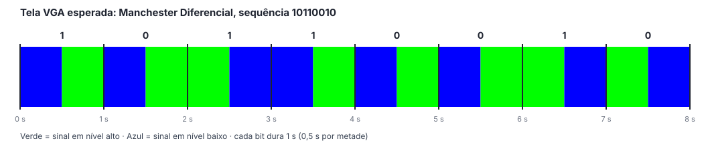

# Tutorial da Saída VGA: Manchester Diferencial com Cores Pulsantes

> Rascunho em Markdown do `tutorial_vga.pdf`. Os trechos **[foto: ...]** e **[print: ...]** marcam onde entram as imagens, que devem ser salvas em `docs/midia/` durante a execução.

Este tutorial mostra como gravar a saída VGA do codificador Manchester Diferencial na Basys 3 e interpretar as cores da tela.

## 1. Pré-requisitos

- Vivado instalado (mesma versão usada no projeto principal)
- Placa Basys 3 e cabo micro-USB
- Monitor com entrada VGA e cabo VGA
- Projeto principal já simulado e testado na placa

## 2. Criação do projeto Vivado

1. Abrir o Vivado e o **Tcl Console** (menu **Window**);
2. Executar:
   ```tcl
   cd C:/fpga/modulacao_manchester_vhdl_fpga/manchester_diferencial/saidas/vga/vivado_project
   source create_project.tcl
   ```
3. Conferir no painel **Sources** que `manchester_dif_vga` é o top da síntese e que `manchester_dif.vhd`, `display_7seg.vhd` e `vga_controller.vhd` aparecem abaixo dele.

**[print: painel Sources do projeto manchester_dif_vga]**

Opcionalmente, rodar **Run Behavioral Simulation**: o testbench do top simula cerca de três quadros de vídeo (50 ms), o que pode levar alguns minutos, e deve terminar com `Simulacao concluida sem erros`.

## 3. Geração do bitstream e gravação

1. Clicar em **Generate Bitstream**;
2. Conectar a placa pelo USB, com o jumper JP1 na posição **JTAG**, e ligar a chave **POWER**;
3. Em **Open Hardware Manager › Open Target › Auto Connect**, clicar em **Program Device**.

**[print: Hardware Manager com a placa programada]**

## 4. Conexão do monitor

1. Ligar o cabo VGA entre o conector VGA da placa e o monitor;
2. Selecionar a entrada VGA no monitor.

O monitor deve reconhecer o modo **640x480 a 60 Hz**. Se aparecer "sem sinal" ou "fora de faixa", conferir o cabo e a seleção de entrada; alguns monitores levam alguns segundos para sincronizar.

**[foto: placa ligada ao monitor]**

## 5. O que observar

| Cor da tela | Nível do sinal codificado |
|---|---|
| Verde | alto (1) |
| Azul | baixo (0) |

Cada bit dura 1 s e a tela **sempre** muda de cor no meio do bit (0,5 s). O valor do bit aparece na passagem de um bit para o outro:

- **bit 0:** a cor muda também no início do bit;
- **bit 1:** a cor do início do bit é a mesma do fim do bit anterior.

Após soltar o BTNC, a transmissão começa a partir do nível baixo (azul).

O LED acima do switch em transmissão acende junto com o verde, e o display de 7 segmentos mostra o número do bit, o que ajuda a acompanhar a sequência.

Sequência esperada para os primeiros bits de `1011001011110000`:



Sequências sugeridas para testar:

| Sequência | O que observar |
|---|---|
| todos em 1 | cores trocam apenas no meio dos bits: blocos de 1 s de cada cor |
| todos em 0 | cores trocam a cada 0,5 s (no início e no meio de todo bit) |
| `1100110011001100` | alterna os dois ritmos acima, mostrando os dois casos da regra |
| BTNC pressionado | tela azul (nível baixo) até soltar o botão |

**[foto/vídeo: tela verde e tela azul, com a placa e o display visíveis]**
