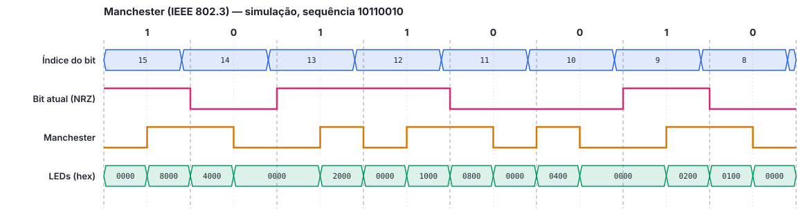
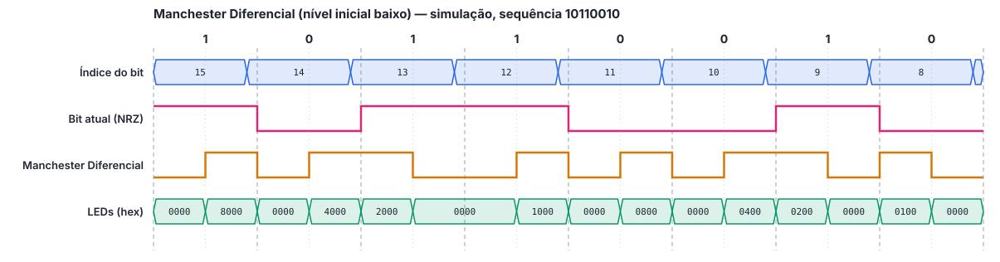
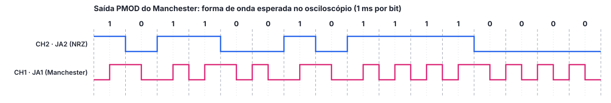
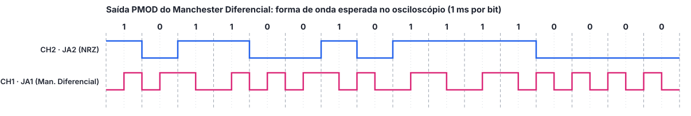
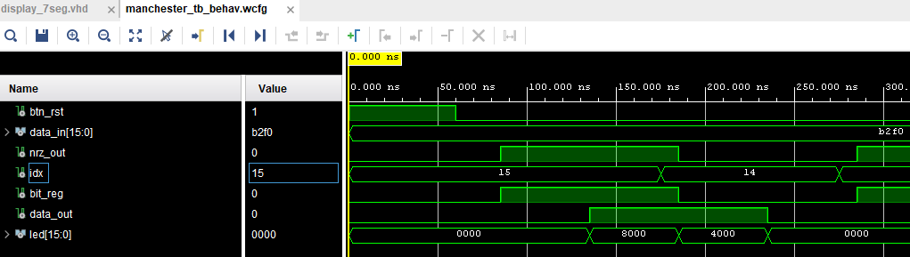
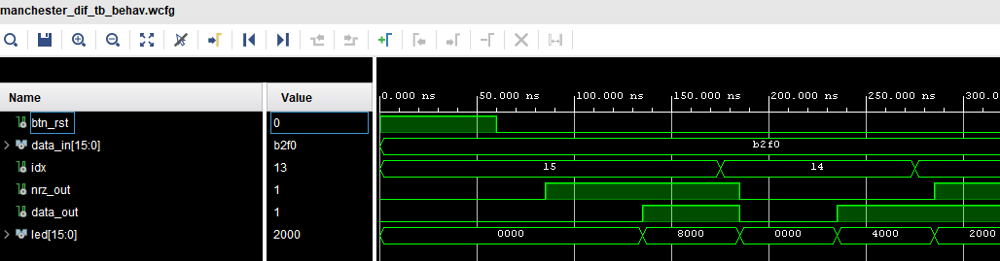

# Relatório Técnico: Codificação de Linha Manchester em VHDL

> Rascunho em Markdown do `relatorio.pdf`. As seções marcadas como **[pendente]** são preenchidas nas fases seguintes, com os resultados de cada integrante. Ao final, o conteúdo deve ser passado para o modelo comum de PDF do grupo. O relatório é escrito no passado e de forma impessoal.

---

## Capa

**Codificação de Linha Manchester e Manchester Diferencial em VHDL (Vivado)**

Comunicação de Dados – Sistemas Reconfiguráveis

Professor(a): **[pendente]**
Instituição: **[pendente]**
Semestre: **[pendente]**
Grupo: **[pendente]**

Integrantes:

- Bianca Ricci
- Diogo Santos Rodrigues
- Gustavo Marmo
- Leonardo Rosário Teixeira
- Ryan Corazza Alvarenga

---

## Resumo

Este trabalho apresentou a implementação, em VHDL, de dois codificadores de linha: Manchester, na convenção IEEE 802.3, e Manchester Diferencial, com nível baixo após o reset. Os circuitos transmitem ciclicamente uma sequência de 16 bits definida pelos switches da placa Basys 3 e apresentam o sinal codificado nos LEDs, em um display de 7 segmentos (número do bit), no conector PMOD, para observação em osciloscópio, e na saída VGA, que muda a cor da tela conforme o nível do sinal. Os testbenches autoverificáveis não apontaram erros no GHDL nem no Vivado Simulator, e a implementação no Vivado 2025.2 atendeu ao clock de 100 MHz com folga (WNS de 2,520 ns e 3,075 ns), usando menos de 1 % dos recursos da FPGA. Medidas feitas sobre as formas de onda simuladas confirmaram a autossincronização, a ausência de componente DC e o dobro de largura de banda dos códigos Manchester em relação ao NRZ, bem como a imunidade do Manchester Diferencial à inversão de polaridade. **[pendente: acrescentar uma frase sobre os resultados na placa, no osciloscópio e no VGA.]**

---

## 1. Introdução

Em sistemas de comunicação digital, os bits precisam ser convertidos em sinais elétricos adequados ao meio de transmissão. Essa conversão é feita pela **codificação de linha**, que define como cada bit, ou sequência de bits, é representado por níveis e transições de tensão. A escolha do código de linha afeta diretamente características como a largura de banda necessária, a presença de componente contínua (DC) e a capacidade do receptor de recuperar o sincronismo a partir do próprio sinal.

Os códigos da família NRZ (*Non-Return-to-Zero*) são simples, mas não garantem transições quando há longas sequências de bits iguais, o que dificulta a sincronização entre transmissor e receptor. Os códigos Manchester resolvem esse problema ao impor uma transição no meio de todo intervalo de bit, tornando o sinal **autossincronizante**, ao custo de aproximadamente o dobro da largura de banda. O código Manchester é utilizado, por exemplo, no Ethernet a 10 Mbit/s (IEEE 802.3).

### 1.1 Objetivo geral

Desenvolver, simular e implementar em FPGA codificadores de linha Manchester e Manchester Diferencial, utilizando a linguagem VHDL e a ferramenta Vivado, e analisar o comportamento dos sinais gerados.

### 1.2 Objetivos específicos

- Implementar em VHDL um codificador Manchester na convenção IEEE 802.3 e um codificador Manchester Diferencial com nível baixo após o reset;
- Verificar o funcionamento dos dois codificadores por simulação comportamental no Vivado Simulator, com testbenches autoverificáveis;
- Implementar os circuitos na placa Basys 3, com a sequência de bits definida pelos switches e o sinal codificado apresentado nos LEDs;
- Observar os sinais codificados em um osciloscópio, por meio do conector PMOD, e em um monitor, por meio da saída VGA;
- Comparar os dois códigos entre si e com os códigos NRZ.

---

## 2. Fundamentação teórica

### 2.1 Codificação de linha e o código NRZ

A codificação de linha associa a cada bit um ou mais elementos de sinal. Uma distinção importante é entre a **taxa de bits** (*N*, em bit/s) e a **taxa de sinalização** ou taxa de modulação (*S*, em baud), que corresponde ao número de elementos de sinal por segundo. A largura de banda necessária para transmitir um sinal digital é proporcional à taxa de sinalização (FOROUZAN, 2010).

No código **NRZ-L** (*Non-Return-to-Zero Level*), o nível do sinal representa diretamente o valor do bit e permanece constante durante todo o intervalo. No **NRZ-I** (*Non-Return-to-Zero Invert*), o bit 1 é representado por uma inversão do nível no início do intervalo e o bit 0 pela ausência de inversão. Nos dois casos, longas sequências de bits iguais (no NRZ-L) ou de zeros (no NRZ-I) produzem um sinal sem transições, o que provoca dois problemas (FOROUZAN, 2010; STALLINGS, 2014):

- **perda de sincronismo:** sem transições, o receptor não consegue corrigir a diferença entre o seu relógio e o do transmissor;
- **componente DC:** um sinal que permanece muito tempo em um mesmo nível tem valor médio diferente de zero, o que é inadequado para meios que não transmitem baixas frequências, como enlaces acoplados por transformador.

### 2.2 Código Manchester

No código **Manchester**, o intervalo de bit é dividido em duas metades e sempre há uma transição no meio do bit. O valor do bit é indicado pelo **sentido** da transição. Existem duas convenções:

| Convenção | Bit 0 | Bit 1 |
|---|---|---|
| **IEEE 802.3** (adotada neste trabalho) | alto → baixo (descida) | baixo → alto (subida) |
| G. E. Thomas | baixo → alto (subida) | alto → baixo (descida) |

Na convenção IEEE 802.3, o sinal Manchester equivale à operação XNOR entre o dado em NRZ-L e um relógio que vale 0 na primeira metade e 1 na segunda metade de cada bit.

### 2.3 Código Manchester Diferencial

No código **Manchester Diferencial**, também há sempre uma transição no meio do bit, mas ela serve apenas ao sincronismo. O valor do bit é indicado pela **presença ou ausência de transição no início** do intervalo: o bit 0 provoca uma inversão do nível no início do bit, e o bit 1 mantém o nível anterior (FOROUZAN, 2010). Como a codificação depende do nível anterior, o codificador precisa de memória, e o sinal gerado depende do nível inicial; neste trabalho, o nível após o reset é baixo.

O Manchester Diferencial combina a ideia do NRZ-I (informação na transição, e não no nível) com a transição no meio do bit do Manchester. Ele é utilizado, por exemplo, nas redes Token Ring (IEEE 802.5).

### 2.4 Autossincronização

Nos dois códigos Manchester há pelo menos uma transição por bit, independentemente da sequência transmitida. O receptor pode usar essas transições para recuperar o relógio do transmissor, sem necessidade de um sinal de relógio separado. Por isso, esses códigos são chamados de **autossincronizantes** (STALLINGS, 2014).

### 2.5 Componente DC

Em ambos os códigos Manchester, cada bit passa metade do intervalo em nível alto e metade em nível baixo. Com níveis simétricos (+V e −V), o valor médio do sinal é nulo em todo intervalo de bit, e o sinal **não possui componente DC**, ao contrário do NRZ (FOROUZAN, 2010).

### 2.6 Largura de banda

A transição obrigatória no meio do bit faz com que o sinal Manchester tenha até duas transições por bit. A taxa de sinalização média é igual à taxa de bits (*S = N*), contra *S = N/2* nos códigos NRZ. Consequentemente, os códigos Manchester exigem **aproximadamente o dobro da largura de banda** de um código NRZ com a mesma taxa de bits (FOROUZAN, 2010).

| Característica | NRZ-L | NRZ-I | Manchester | Manchester Diferencial |
|---|---|---|---|---|
| Informação no(a) | nível | transição no início do bit | sentido da transição no meio | transição no início do bit |
| Transições por bit | 0 a 1 | 0 a 1 | 1 a 2 | 1 a 2 |
| Autossincronizante | não | não | sim | sim |
| Componente DC | sim | sim | não | não |
| Largura de banda relativa | 1× | 1× | ≈ 2× | ≈ 2× |
| Sensível à inversão de polaridade | sim | não | sim | não |

### 2.7 Inversão de polaridade

Se os fios de um par forem trocados, todos os níveis do sinal são invertidos. No Manchester, isso inverte o sentido de todas as transições do meio do bit e, portanto, **inverte todos os bits** recebidos. No Manchester Diferencial, a informação está na presença ou ausência de transição, e não no sentido; uma inversão de polaridade preserva as transições e **não altera os dados** (STALLINGS, 2014).

---

## 3. Metodologia

O trabalho foi organizado nas seguintes etapas:

1. **Estudo** dos códigos de linha e da especificação do trabalho;
2. **Implementação em VHDL** dos dois codificadores, a partir de uma interface comum (`clk`, `btn_rst`, `data_in`, `data_out`, `nrz_out`, `led`, `seg`, `an` e o generic `CYCLES_PER_BIT`), o que permitiu o desenvolvimento em paralelo das saídas PMOD e VGA;
3. **Simulação comportamental**, inicialmente no simulador livre GHDL e depois no Vivado Simulator, com testbenches que verificam automaticamente, por meio de `assert`, o nível esperado em cada metade de cada bit;
4. **Síntese, implementação e geração do bitstream** no Vivado;
5. **Gravação na placa** Basys 3 e testes com diferentes sequências nos switches;
6. **Observação dos sinais** no osciloscópio (saída PMOD) e no monitor (saída VGA).

O desenvolvimento foi dividido entre os integrantes e acompanhado por *issues* no repositório Git do grupo.

**Ferramentas utilizadas:** AMD Vivado 2025.2, Vivado Simulator, GHDL, placa Digilent Basys 3 (FPGA Artix-7 `xc7a35tcpg236-1`), osciloscópio **[pendente: modelo]**, monitor VGA e Git/GitHub.

---

## 4. Desenvolvimento

> Rascunho baseado no código do repositório. Cada responsável deve revisar o trecho do seu bloco e acrescentar as dificuldades encontradas no Vivado e na placa.

### 4.1 Estrutura comum aos dois codificadores

Os dois codificadores foram implementados com a mesma estrutura e a mesma interface (`clk`, `btn_rst`, `data_in`, `data_out`, `nrz_out`, `led`, `seg` e `an`, além do generic `CYCLES_PER_BIT`). A interface foi definida no início do trabalho, o que permitiu desenvolver as saídas PMOD e VGA e a documentação em paralelo com os codificadores.

O circuito foi dividido nos blocos sugeridos no enunciado:

- **sincronizador do botão:** o sinal do BTNC, assíncrono em relação ao clock, passa por dois flip-flops antes de ser usado como reset síncrono;
- **contador de ciclos:** conta de 0 a `CYCLES_PER_BIT − 1`; o valor 0 marca o início do bit e `CYCLES_PER_BIT/2` marca o meio. Optou-se por exigir `CYCLES_PER_BIT` par, verificado por um `assert` que interrompe a síntese e a simulação em caso contrário, para que as duas metades do bit tenham exatamente a mesma duração;
- **índice do bit:** decrementa de 15 a 0 a cada fim de bit e volta a 15, selecionando o switch e o LED;
- **leitura do switch no início do bit:** o valor de `data_in(índice)` é lido apenas quando o contador está em 0 e guardado em um registrador, de modo que alterar um switch no meio do intervalo só afeta a próxima transmissão daquele bit;
- **saídas registradas:** o sinal codificado, o dado original e o vetor de LEDs saem de flip-flops, evitando pulsos espúrios no osciloscópio.

A duração do bit adotada na placa foi de 1 s (`CYCLES_PER_BIT = 100_000_000`), dentro da faixa recomendada de 1 a 2 s, e de 1 ms (`CYCLES_PER_BIT = 100_000`) na saída PMOD, resultando em uma taxa de 1 kbit/s, adequada ao osciloscópio. Nos testbenches, foram usados 10 ciclos por bit com clock de 10 ns (`BIT_PERIOD = 100 ns`).

### 4.2 Codificador Manchester

A partir da tabela-verdade do código na convenção IEEE 802.3, observou-se que a saída depende apenas do bit atual e da metade do bit (0 na primeira metade e 1 na segunda), e que ela corresponde à porta **XNOR** entre os dois sinais. Assim, o codificador foi reduzido a uma única porta lógica seguida do flip-flop de saída.

### 4.3 Codificador Manchester Diferencial

Como a saída depende do nível anterior, foi utilizado um registrador que armazena o último nível transmitido e que também alimenta diretamente a saída `data_out`. No início de cada bit, o registrador é invertido se o bit for 0 e mantido se for 1; no meio do bit, é sempre invertido. No reset, o registrador vai para nível baixo, como exige o enunciado.

### 4.4 Display de 7 segmentos

Foi incluído o display de 7 segmentos, sugerido no enunciado, para mostrar o número do bit em transmissão. Como os quatro dígitos compartilham os segmentos, adotou-se a multiplexação: os dois dígitos usados (dezena e unidade) são acesos alternadamente a cerca de 380 Hz cada.

### 4.5 Saídas PMOD e VGA

Para as saídas, foram criados tops separados em cada projeto, que instanciam o mesmo núcleo sem alterá-lo, mudando apenas o generic e o mapeamento de pinos. Na saída PMOD, o sinal codificado foi ligado ao pino JA1 e o dado original ao JA2. Na saída VGA, foi desenvolvido um controlador 640x480 a 60 Hz, com clock de pixel de 25 MHz obtido por um sinal de habilitação a cada quatro ciclos do clock de 100 MHz; a tela inteira é pintada de verde quando o sinal está em nível alto e de azul em nível baixo. Optou-se por não reiniciar o controlador VGA pelo BTNC, para que o monitor não perca o sincronismo a cada reset.

### 4.6 Verificação

Os testbenches foram escritos de forma autoverificável: em vez de depender apenas da inspeção visual, eles comparam a saída com o valor esperado, por meio de `assert`, no meio de cada metade de cada bit, e informam ao final se houve erros. No Manchester Diferencial, o testbench acompanha o nível esperado a partir do reset. Também foram verificados o reset no meio da transmissão, a troca de switches entre voltas e a alteração de um switch durante um bit.

Antes do uso do Vivado, os códigos foram compilados e simulados com o simulador livre GHDL, nos padrões VHDL-93 e VHDL-2008. Para confirmar que os testbenches detectam falhas, foram simuladas versões propositalmente erradas dos circuitos (por exemplo, com a convenção de Thomas, sem a inversão no meio do bit ou com o reset em nível alto); todas foram apontadas pelos testbenches.

### 4.7 Dificuldades encontradas

- **Identificadores que diferem apenas em maiúsculas:** em uma primeira versão, a constante `HALF` e a variável `half` coexistiam no mesmo código. Como o VHDL não diferencia maiúsculas de minúsculas, os dois nomes se referiam ao mesmo identificador e o código não compilava. Os nomes foram trocados por `HALF_BIT` e `metade`;
- **Condição de corrida no testbench:** a troca dos switches no testbench ocorria no mesmo instante da borda de clock em que o circuito lia o switch, gerando falsos erros. Os pontos de verificação foram deslocados meio ciclo antes das bordas de leitura;
- **Portas sem pino:** como o Vivado não gera o bitstream quando uma porta do top não tem pino definido, as saídas `data_out` e `nrz_out` foram mapeadas no PMOD também nos projetos principais;
- **Caminhos no Tcl Console do Vivado:** na primeira execução dos scripts de criação dos projetos, o caminho da pasta foi digitado com barras invertidas (`C:\...`). No Tcl, a barra invertida é um caractere de escape, e o comando `cd` falhou. O problema foi resolvido usando barras normais (`C:/...`), o que passou a constar nos tutoriais;
- **Sinais adicionados após a simulação:** sinais internos arrastados para a janela de forma de onda depois da execução apareceram vazios, pois o Vivado Simulator só registra os sinais presentes na janela durante a simulação. Foi necessário reiniciar e executar de novo a simulação (`restart` e `run 4us`);
- **Perda de alterações em um *merge*:** ao resolver um conflito na integração das *branches*, os arquivos do projeto Manchester voltaram à versão anterior ao display de 7 segmentos, o que impedia a compilação do top VGA. O problema foi detectado pela regressão automática dos testbenches e da síntese e corrigido restaurando os arquivos;
- **[pendente]** dificuldades encontradas na placa.

---

## 5. Resultados

### 5.1 Simulação

Os testbenches dos dois codificadores foram executados no GHDL e terminaram sem nenhum erro de `assert`, nos padrões VHDL-93 e VHDL-2008. O mesmo ocorreu com os testbenches do display de 7 segmentos, do controlador VGA e dos tops das saídas PMOD (simulados na taxa real de 1 ms por bit) e VGA (cerca de três quadros de vídeo). As simulações dos dois codificadores foram repetidas no Vivado Simulator 2025.2, com o mesmo resultado: o testbench terminou aos 3870 ns com a mensagem `Simulacao concluida sem erros` nos dois projetos.

As figuras a seguir mostram os oito primeiros bits da sequência de teste, `10110010`, que é o exemplo do enunciado. Em ambos os códigos, o índice do bit decrementa de 15 a 8, há transição no meio de todos os bits e apenas o LED da posição em transmissão recebe o sinal.

*Figura 1: Simulação do codificador Manchester (IEEE 802.3) para a sequência 10110010.*

*Figura 2: Simulação do codificador Manchester Diferencial, a partir do nível baixo, para a sequência 10110010.*

As formas de onda esperadas no osciloscópio foram obtidas da simulação dos tops PMOD, com o dado original (NRZ) e o sinal codificado para a volta completa de 16 bits:

*Figura 3: Saída PMOD do Manchester simulada (1 ms por bit).*

*Figura 4: Saída PMOD do Manchester Diferencial simulada (1 ms por bit).*

As Figuras 5 e 6 mostram a simulação no Vivado Simulator, com zoom nos dois primeiros bits após o reset (bit 15 = 1 e bit 14 = 0). No Manchester, o bit 1 aparece como baixo → alto e o bit 0 como alto → baixo, e a saída permanece alta na fronteira entre eles. No Manchester Diferencial, os dois bits aparecem como baixo → alto, e a diferença entre eles está na fronteira: a saída cai no início do bit 0 (inversão) e não muda no início do bit 1.

*Figura 5: Simulação do Manchester no Vivado Simulator (índice, bit atual, sinal codificado e LEDs).*

*Figura 6: Simulação do Manchester Diferencial no Vivado Simulator.*

### 5.2 Síntese

Antes do uso do Vivado, os seis tops (os dois projetos principais e as saídas PMOD e VGA de cada um) foram sintetizados com o sintetizador do GHDL, sem erros nem avisos. As *netlists* sintetizadas dos dois codificadores foram simuladas com os mesmos testbenches e também não apresentaram erros, o que indica que o comportamento descrito em VHDL é preservado na síntese.

No Vivado 2025.2, os seis projetos foram sintetizados e implementados e tiveram o *bitstream* gerado com sucesso. Os resultados dos projetos principais, para a FPGA Artix-7 `xc7a35tcpg236-1`, estão na tabela a seguir:

| Projeto | WNS (clock de 100 MHz) | LUTs | Flip-flops |
|---|:---:|:---:|:---:|
| Manchester | 2,520 ns | 39 | 77 |
| Manchester Diferencial | 3,075 ns | 44 | 77 |

O WNS (*Worst Negative Slack*) positivo indica que todos os caminhos do circuito atendem ao período de 10 ns do clock, com folga. Os dois circuitos ocupam menos de 1 % dos recursos da FPGA (20 800 LUTs e 41 600 flip-flops). O Manchester Diferencial usa 5 LUTs a mais, correspondentes à lógica da regra de transição, e o número de flip-flops é o mesmo nos dois projetos. A maior parte dos flip-flops corresponde ao contador de ciclos de 27 bits, aos 16 LEDs registrados e ao contador de multiplexação de 17 bits do display. **[pendente: analisar os avisos da aba *Methodology* do Vivado (46 avisos no projeto diferencial).]**

### 5.3 Placa, osciloscópio e VGA

**[pendente]**

- Fotos da placa em funcionamento, com os testes do tutorial da placa;
- Capturas do osciloscópio (saída PMOD), com os sinais e as transições do meio do bit identificados;
- Fotos ou vídeo da tela VGA.

---

## 6. Análise e discussão

### 6.1 Medidas a partir da simulação

Para comparar os códigos de forma objetiva, as formas de onda simuladas dos tops PMOD (Figuras 3 e 4) foram analisadas ao longo de uma volta completa da sequência `1011001011110000` (16 bits de 1 ms):

| Medida | NRZ (dado original) | Manchester | Manchester Diferencial |
|---|:---:|:---:|:---:|
| Transições em 16 bits | 7 | 24 | 24 |
| Transições por bit | 0,44 | 1,50 | 1,50 |
| Maior intervalo sem transição | 4 ms (4 bits) | 1 ms (1 bit) | 1 ms (1 bit) |
| Tempo em nível alto | 50 % | 50 % | 50 % |

Nos dois códigos Manchester, as 24 transições correspondem às 16 transições do meio do bit, sempre presentes, mais 8 transições de fronteira entre bits. Já o NRZ ficou até 4 ms sem nenhuma transição (nos trechos `1111` e `0000`), intervalo em que um receptor não teria referência para corrigir o seu relógio. Nos códigos Manchester, o maior intervalo sem transição foi de um bit, independentemente da sequência, o que evidencia a autossincronização.

O tempo em nível alto foi de 50 % nos três sinais, mas por razões diferentes: no NRZ, isso ocorreu apenas porque a sequência escolhida tem oito bits 1 e oito bits 0; com todos os switches em 1, o NRZ ficaria 100 % do tempo em nível alto, ou seja, com componente DC máxima. Nos códigos Manchester, cada bit tem uma metade em nível alto e outra em nível baixo, de modo que o valor médio é o mesmo em qualquer sequência.

### 6.2 Largura de banda

Com 1 kbit/s, o sinal NRZ de maior frequência é a sequência alternada `1010...`, uma onda quadrada de 500 Hz. Nos códigos Manchester, sequências de bits iguais (todos 1 ou todos 0 no Manchester; todos 0 no Diferencial) produzem uma onda quadrada de 1 kHz, com pulsos de 0,5 ms. A frequência fundamental máxima dobrou em relação ao NRZ, confirmando que os códigos Manchester exigem aproximadamente o dobro da largura de banda para a mesma taxa de bits.

### 6.3 Inversão de polaridade

Para avaliar o efeito de uma inversão de polaridade (fios do par trocados), as formas de onda simuladas foram invertidas e decodificadas:

| Código | Bits decodificados do sinal original | Bits decodificados do sinal invertido |
|---|---|---|
| Manchester | `1011001011110000` | `0100110100001111` (todos os bits invertidos) |
| Manchester Diferencial | `1011001011110000` | `1011001011110000` (sem alteração) |

No Manchester, a inversão troca o sentido de todas as transições do meio do bit e, portanto, inverte todos os bits. No Manchester Diferencial, a informação está na presença ou ausência de transição no início do bit, que a inversão preserva; os dados são recuperados corretamente, desde que o receptor tome como referência o nível realmente recebido (no sinal invertido, o nível de partida passa a ser alto).

### 6.4 Comparação entre Manchester e Manchester Diferencial

| Aspecto | Manchester | Manchester Diferencial |
|---|---|---|
| Onde está a informação | sentido da transição no meio do bit | presença de transição no início do bit |
| Memória no codificador | não (porta XNOR) | sim (registrador do último nível) |
| Dependência do nível inicial | não | sim (nível baixo após o reset) |
| Inversão de polaridade | inverte os dados | não afeta os dados |
| Leitura a olho nu nos LEDs | direta (apagado→aceso = 1) | exige comparar com o LED anterior |
| Autossincronização, componente DC e largura de banda | iguais nos dois códigos | iguais nos dois códigos |

O Manchester foi mais simples de implementar e de interpretar na placa, pois cada bit pode ser lido isoladamente. O Manchester Diferencial exigiu um elemento de memória e uma condição inicial definida, mas oferece imunidade à inversão de polaridade.

### 6.5 Simulação e placa

**[pendente]** Comparar o comportamento observado na placa, no osciloscópio e no monitor com as Figuras 1 a 4 (ordem dos LEDs, metades do bit, reset, troca de switches) e comentar eventuais diferenças, como a latência de 3 ciclos de clock após o reset, imperceptível na placa.

---

## 7. Conclusões

Os dois codificadores foram implementados em VHDL com uma estrutura comum, o que permitiu reaproveitar os mesmos blocos de contagem, seleção de bit, display e saídas, e desenvolver as saídas PMOD e VGA em paralelo. A codificação Manchester na convenção IEEE 802.3 se reduziu a uma porta XNOR entre o bit atual e a metade do bit, enquanto o Manchester Diferencial exigiu um elemento de memória e uma condição inicial definida. Os resultados de simulação e as medidas feitas sobre as formas de onda confirmaram as propriedades teóricas estudadas: pelo menos uma transição por bit, ausência de componente DC, cerca do dobro da largura de banda do NRZ e, no caso do Diferencial, imunidade à inversão de polaridade.

Do ponto de vista metodológico, o uso de testbenches autoverificáveis, da pré-validação no GHDL e de scripts para criar os projetos Vivado permitiu detectar erros antes do uso da placa, incluindo uma regressão introduzida durante a integração do código, e tornou os projetos reproduzíveis por qualquer integrante.

Como limitações, a duração do bit é fixada em tempo de síntese, sendo necessário gerar um *bitstream* diferente para os LEDs (1 s por bit) e para o osciloscópio (1 ms por bit), e o trabalho não inclui um decodificador. Como trabalhos futuros, sugerem-se a seleção da taxa de bits por switches ou botões, a implementação dos decodificadores com recuperação de relógio a partir das transições do sinal e a transmissão entre duas placas pelo conector PMOD.

**[pendente]** Acrescentar as conclusões sobre o funcionamento na placa, no osciloscópio e no VGA.

---

## Referências

> Conferir edição, ano e editora de cada obra efetivamente consultada antes da versão final.

DIGILENT. **Basys 3 Reference Manual**. Pullman: Digilent, [s.d.]. Disponível em: https://digilent.com/reference/programmable-logic/basys-3/reference-manual. Acesso em: **[pendente]**.

DIGILENT. **Basys-3-Master.xdc**. Repositório digilent-xdc. Disponível em: https://github.com/Digilent/digilent-xdc. Acesso em: **[pendente]**.

FOROUZAN, B. A. **Comunicação de dados e redes de computadores**. 4. ed. Porto Alegre: AMGH, 2010.

IEEE. **IEEE Std 802.3: IEEE Standard for Ethernet**. New York: IEEE, 2022.

STALLINGS, W. **Data and computer communications**. 10. ed. Upper Saddle River: Pearson, 2014.

TANENBAUM, A. S.; WETHERALL, D. **Redes de computadores**. 5. ed. São Paulo: Pearson Prentice Hall, 2011.
